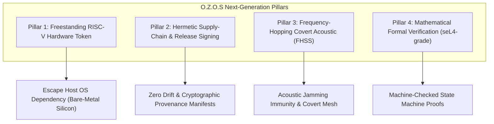

# O.Z.O.S Sovereign Evolution Roadmap & Hardened Mandates
## Post-Round 13 Strategic Architectural Directive

---

> *"Security is not a product, but a process of continuous adversarial hardening. In a sovereign system, mathematics is the only law, and physical invariants are the only boundaries."*

Following the exhaustive 13-round adversarial audit gauntlet conducted by the Red Team, this document establishes the **Mandatory Next-Generation Engineering Directives** for O.Z.O.S (Omni-Zero Operating Shield).

---

## Part I: Post-Mortem Retrospective & Core Lessons (Rounds 1–13)

### 1. The Glue Code & Coercion Trap (Lỗ Hổng Nằm Ở Mép Nối)
* **Empirical Fact:** Cryptographic primitives (Ed25519, X25519, Poly1305, 2D-DCT) were never broken mathematically. Vulnerabilities emerged exclusively at platform boundaries:
  - Language type coercion (e.g., Python `isinstance(True, int) == True`, JS silent fallback on unparseable floors).
  - Unbounded integer wraps (e.g., JS `DataView.setBigUint64` wrapping modulo $2^{64}$ without exceptions).
  - Permissive CLI flag parsers silently swallowing misspelled options (e.g., `--pinned-peer-pubky`).
* **Sovereign Invariant:** Every boundary must operate on a **strict fail-closed parsing model**. Any unexpected character, boolean coercion, or malformed flag must immediately abort execution with exit code 1.

### 2. Elimination of "Security Theater" (Tuyệt Đối Không Trấn An Giả Tạo)
* **Empirical Fact:** Verification tools that note anomalies without non-zero exit codes (e.g., audit scripts alerting on source drift while returning 0) create false confidence worse than missing features. Similarly, displaying "VERIFIED" verdicts before validating pinned trust anchors creates fatal blind spots.
* **Sovereign Invariant:** If an integrity condition is not 100% verified, the system must fail deadly. Documentation and runtime outputs must disclose exact cryptographic states without aspirational claims.

### 3. Physical Airspaces Are Open Broadcast Domains
* **Empirical Fact:** Hann-windowed near-ultrasound (18.1–19.8 kHz) is inaudible to human ears, but perfectly audible to recording sensors, loudspeakers, and RF/acoustic transceivers. Unauthenticated acoustic handshakes permit trivial replay, spoofing, and selective jamming.
* **Sovereign Invariant:** Physical acoustic links must always be treated as unauthenticated, adversarial broadcast media. Mutual peer authentication via pinned public keys (`--pinned-peer-pubkey`) and Perfect Forward Secrecy (PFS) are mandatory for unattended environments.

### 4. The Fail-Deadly Principle (Chết Sạch Để Bảo Vệ Chủ Quyền)
* **Empirical Fact:** Attempting to recover from fault injections (laser glitches, clock glitches, corrupted Merkle roots) risks leaking intermediate key residue.
* **Sovereign Invariant:** Upon detecting state corruption, the microkernel executes emergency volatile RAM zeroization (NIST SP 800-88 compliant 3-pass purge), asserts hardware crowbar resets, and collapses execution to void.

---

## Part II: Mandatory Next-Generation Engineering Mandates

---

### Pillar 1: Freestanding RISC-V Hardware Token (Thoát Ly Khỏi Host OS)
* **Objective:** Decouple O.Z.O.S from host OS dependencies (Windows/Linux/macOS) by compiling the C99 microkernel into a freestanding, zero-libc (`-nostdlib`) firmware image.
* **Target Platforms:** Ultra-low-cost, auditable RISC-V microcontrollers (e.g. ESP32-S3 with hardware crypto accelerators, CH32V series).
* **Hardware Form Factor:**
  - Thumb-sized standalone identity authenticator.
  - Hardware components: Dedicated MEMS microphone, piezoelectric transducer, physical hardware kill-switch.
  - Zero network stacks: Zero Wi-Fi, Zero Bluetooth, Zero USB CDC data channels during active operational mode.
  - Physical interaction: Place near laptop/workstation to conduct inaudible air-gapped cryptographic handshakes.

---

### Pillar 2: Hermetic Supply-Chain & Automated Detached Signing
* **Objective:** Completely close the loop between C++ source files, WebAssembly binaries, and distributed release artifacts.
* **Requirements:**
  1. **Hermetic Deterministic Container:** Build environment (Docker/Nix) pinning exact LLVM/Emscripten toolchain versions to guarantee bit-exact byte-for-byte reproducibility across all platforms.
  2. **Automated Source-WASM Synchronization:** Git pre-commit and CI verification running `check_wasm_staleness.py --fail-on-drift` to strictly forbid C++ commits without regenerated, bit-exact WASM binaries.
  3. **Detached Release Signatures:** Automated milestone release packaging producing `SHA256SUMS` manifests accompanied by detached Ed25519 signatures authored by `LumenNull`.

---

### Pillar 3: Frequency-Hopping Spread Spectrum (FHSS Acoustic Stealth)
* **Objective:** Upgrade the physical acoustic carrier from fixed dual-tone 16-FSK bands to pseudorandom frequency-hopping modulation.
* **Mechanics:**
  - **Dynamic Carrier Hopping:** The frequency slot for each transmitted byte is determined by a PRNG seeded with ephemeral handshake shared entropy ($K_{session}$ or peer anchor).
  - **Jamming & Eavesdropping Resistance:** Selective frequency noise blasts cannot disrupt transmissions without jamming the entire ultrasonic spectrum.
  - **Multi-Hop Store-and-Forward Mesh:** Enable peer nodes to relay signed encrypted payloads across air-gapped physical rooms without RF signals or wired interconnects.

---

### Pillar 4: Mathematical Formal Verification (seL4-Style Proofs)
* **Objective:** Mathematically prove the absence of runtime flaws in the 15-tier invariant state engine using formal verification languages (TLA+ or Lean 4).
* **Target Proof Theorems:**
  1. **Zero-Replay Theorem:** Formally prove that no execution trajectory allows processing a packet with $Nonce \le Nonce_{last\_seen}$.
  2. **Zero-Deadlock Theorem:** Formally prove that the acoustic state machine terminates within finite, bounded time cycles across all possible input streams.
  3. **Constant-Time Memory Zeroization Theorem:** Formally prove that sensitive cryptographic buffers are guaranteed to be purged from cache and volatile RAM prior to function return.

---

## Part III: Commitment & Sovereign Covenant

This roadmap is an immutable mandate for all future development sprints of O.Z.O.S. Every new feature, protocol revision, or platform port must strictly satisfy the 4 Retrospective Lessons and advance towards the 4 Core Mandates.

*Sealed and recorded into the canonical repository on November 3, 2026.*  
**Author:** LumenNull & ZeroStudio  
**Status:** ACTIVE MANDATE  
