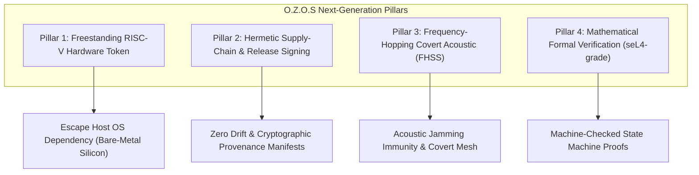
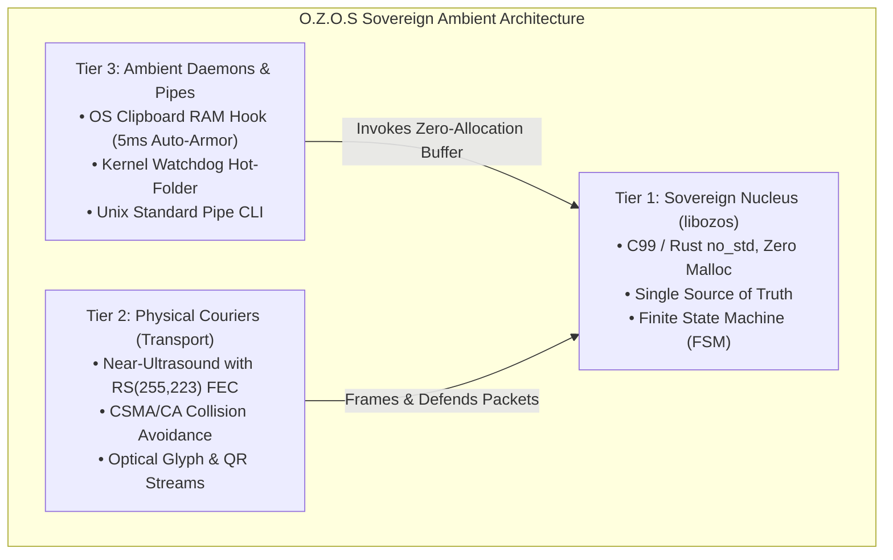

# O.Z.O.S Sovereign Evolution Roadmap & Hardened Mandates
## Post-Round 13 Strategic Architectural Directive

---

> *"Security is not a product, but a process of continuous adversarial hardening. In a sovereign system, mathematics is the only law, and physical invariants are the only boundaries."*

Following the exhaustive 13-round adversarial audit gauntlet conducted by the Red Team, this document establishes the **Mandatory Next-Generation Engineering Directives** for O.Z.O.S (Omni-Zero Operating Shield).

---

## Part I: Post-Mortem Retrospective & Core Lessons (Rounds 1–13)

### 1. The Glue Code & Coercion Trap (Perimeter Boundary Vulnerabilities)
* **Empirical Fact:** Cryptographic primitives (Ed25519, X25519, Poly1305, 2D-DCT) were never broken mathematically. Vulnerabilities emerged exclusively at platform boundaries:
  - Language type coercion (e.g., Python `isinstance(True, int) == True`, JS silent fallback on unparseable floors).
  - Unbounded integer wraps (e.g., JS `DataView.setBigUint64` wrapping modulo $2^{64}$ without exceptions).
  - Permissive CLI flag parsers silently swallowing misspelled options (e.g., `--pinned-peer-pubky`).
* **Sovereign Invariant:** Every boundary must operate on a **strict fail-closed parsing model**. Any unexpected character, boolean coercion, or malformed flag must immediately abort execution with exit code 1.

### 2. Elimination of "Security Theater" (Zero Deceptive Assurance)
* **Empirical Fact:** Verification tools that note anomalies without non-zero exit codes (e.g., audit scripts alerting on source drift while returning 0) create false confidence worse than missing features. Similarly, displaying "VERIFIED" verdicts before validating pinned trust anchors creates fatal blind spots.
* **Sovereign Invariant:** If an integrity condition is not 100% verified, the system must fail deadly. Documentation and runtime outputs must disclose exact cryptographic states without aspirational claims.

### 3. Physical Airspaces Are Open Broadcast Domains
* **Empirical Fact:** Hann-windowed near-ultrasound (18.1–19.8 kHz) is inaudible to human ears, but perfectly audible to recording sensors, loudspeakers, and RF/acoustic transceivers. Unauthenticated acoustic handshakes permit trivial replay, spoofing, and selective jamming.
* **Sovereign Invariant:** Physical acoustic links must always be treated as unauthenticated, adversarial broadcast media. Mutual peer authentication via pinned public keys (`--pinned-peer-pubkey`) and Perfect Forward Secrecy (PFS) are mandatory for unattended environments.

### 4. The Fail-Deadly Principle (Total Sanitization to Protect Sovereignty)
* **Empirical Fact:** Attempting to recover from fault injections (laser glitches, clock glitches, corrupted Merkle roots) risks leaking intermediate key residue.
* **Sovereign Invariant:** Upon detecting state corruption, the microkernel executes emergency volatile RAM zeroization (NIST SP 800-88 compliant 3-pass purge), asserts hardware crowbar resets, and collapses execution to void.

---

## Part II: Mandatory Next-Generation Engineering Mandates

---

### Pillar 1: Freestanding RISC-V Hardware Token (Decoupled from Host OS)
* **Objective:** Decouple O.Z.O.S from host OS dependencies (Windows/Linux/macOS) by compiling the C99 microkernel into a freestanding, zero-libc (`-nostdlib`) firmware image.
* **Target Platforms:** Ultra-low-cost, auditable RISC-V microcontrollers (e.g. ESP32-S3 with hardware crypto accelerators, CH32V series).
* **Hardware Form Factor:**
  - Thumb-sized standalone identity authenticator.
  - Hardware components: Dedicated MEMS microphone, piezoelectric transducer, physical hardware kill-switch.
  - Zero network stacks: Zero Wi-Fi, Zero Bluetooth, Zero USB CDC data channels during active operational mode.
  - Physical interaction: Place near laptop/workstation to conduct inaudible air-gapped cryptographic handshakes.

---

### Pillar 2: Hermetic Supply-Chain & Automated Detached Signing
* **Objective:** Completely close the loop between C++ source files, WebAssembly binaries, and distributed release artifacts.
* **Requirements:**
  1. **Hermetic Deterministic Container:** Build environment (Docker/Nix) pinning exact LLVM/Emscripten toolchain versions to guarantee bit-exact byte-for-byte reproducibility across all platforms.
  2. **Automated Source-WASM Synchronization:** Git pre-commit and CI verification running `check_wasm_staleness.py --fail-on-drift` to strictly forbid C++ commits without regenerated, bit-exact WASM binaries.
  3. **Detached Release Signatures:** Automated milestone release packaging producing `SHA256SUMS` manifests accompanied by detached Ed25519 signatures authored by `LumenNull`.

---

### Pillar 3: Frequency-Hopping Spread Spectrum (FHSS Acoustic Stealth)
* **Objective:** Upgrade the physical acoustic carrier from fixed dual-tone 16-FSK bands to pseudorandom frequency-hopping modulation.
* **Mechanics:**
  - **Dynamic Carrier Hopping:** The frequency slot for each transmitted byte is determined by a PRNG seeded with ephemeral handshake shared entropy ($K_{session}$ or peer anchor).
  - **Jamming & Eavesdropping Resistance:** Selective frequency noise blasts cannot disrupt transmissions without jamming the entire ultrasonic spectrum.
  - **Multi-Hop Store-and-Forward Mesh:** Enable peer nodes to relay signed encrypted payloads across air-gapped physical rooms without RF signals or wired interconnects.

---

### Pillar 4: Mathematical Formal Verification (seL4-Style Proofs)
* **Objective:** Mathematically prove the absence of runtime flaws in the 15-tier invariant state engine using formal verification languages (TLA+ or Lean 4).
* **Target Proof Theorems:**
  1. **Zero-Replay Theorem:** Formally prove that no execution trajectory allows processing a packet with $Nonce \le Nonce_{last\_seen}$.
  2. **Zero-Deadlock Theorem:** Formally prove that the acoustic state machine terminates within finite, bounded time cycles across all possible input streams.
  3. **Constant-Time Memory Zeroization Theorem:** Formally prove that sensitive cryptographic buffers are guaranteed to be purged from cache and volatile RAM prior to function return.

---

## Part III: The Sovereign Paradigm Shift — The Zero-UI Ambient Architecture (Round 18+ Mandate)

### 1. The Art of Subtraction & De-Bloating (Eliminating the Web/App Trap)
* **Empirical Diagnosis:** 17 rounds of adversarial testing proved that 90% of regressions, port collisions, path traversals, and glue-code failures originated from the web cockpit layer (`server.py`, port 8899, V8 JavaScript runtime, browser DevTools workarounds).
* **Architectural Mandate:** O.Z.O.S permanently repudiates mandatory web servers, local HTTP ports, and bloated UI runtimes. The system transforms into a **formless, zero-UI ambient infrastructure protocol** running silently at the OS micro-kernel and daemon level.

### 2. Single Source of Truth (SSOT) & Finite State Machine (FSM)
* **Single Nucleus (`libozos`):** All packet framing, validation, and cryptographic state evaluations are consolidated strictly into a single C99/`no_std` Rust library. Duplicate parser implementations in Python and JavaScript are completely eliminated; peripheral tools interact purely via raw binary buffers and foreign function interfaces (FFI).
* **Strict Fail-Closed FSM:** Eliminates fragile, nested heuristic `if/else` ladders. Packets are evaluated through a rigid 4-state transition table: `[UNVERIFIED] -> [MAC_VALID] -> [NONCE_VALID] -> [SIGNATURE_VALID]`. Any deviation or corrupted bit immediately triggers `STATE_ABORT` and volatile zeroization at byte zero.

### 3. Invisible Ambient Guardian (`ozos-daemon`)
* **Clipboard RAM Auto-Armor (`Win+Shift+S` / `Ctrl+C` -> `Ctrl+V`):**
  - Registered OS kernel hook (`AddClipboardFormatListener` on Windows / X11/Wayland clipboard listener on Linux).
  - Intercepts copied bitmap buffers in memory; injects imperceptible 2D-DCT 8x8 watermark, 80-byte header, and Ed25519 detached signature in **< 5 milliseconds**.
  - Users paste into email, messaging apps, or banking portals with zero friction and zero GUI interaction, carrying indelible identity provenance.
* **Kernel Watchdog Hot-Folder:** Automated filesystem monitoring (`ReadDirectoryChangesW` / `inotify`) applying instantaneous on-the-fly protection to dropped assets.
* **Unix Pipe Standard:** Headless streaming pipeline integration (`cat document.bmp | ozos armor > secured.bmp`).

### 4. Data-at-Rest Retroactive Protection Suite (Legacy Filesystem Security)
* **Batch Retroactive Armoring (`ozos sweep <dir>`):** Recursively traverses local directories, applying 2D-DCT 8x8 mid-frequency watermarks and Ed25519 detached signatures to existing image files at wire speed (> 100 images/sec via native C99 execution), armoring legacy digital identities without manual user interaction.
* **Hermetic Local Enclave Vault (`ozos vault pack/open`):** Compresses and encrypts existing sensitive document directories into sealed `.ozos` containers using **XSalsa20-Poly1305** authenticated encryption keyed from the 12-word Brainseed. Access operations decrypt strictly into transient RAM disks, zeroizing memory upon closure and never writing plaintext residue to persistent NAND flash.
* **Zero-Touch Merkle Provenance Anchor (`ozos anchor <dir>`):** For legally immutable or read-only files, computes a binary Merkle tree over the directory snapshot, outputting a 32-byte Merkle Root signed with Ed25519 and timestamped nonces. Establishes mathematical proof of existence and historical ownership without modifying a single bit of the original files.
* **Hardware Anti-Forensic Sanitization (`ozos burn <file>`):** Implements NIST SP 800-88 compliant 3-pass hardware sanitization (`0xAA` -> `0x55` -> `0x00`) with kernel controller flush barriers (`FlushFileBuffers` / `fdatasync`), permanently eliminating unarmored legacy drafts from physical magnetic/solid-state media.

### 5. Tri-Modal Air-Gap Physical Transport Architecture (Zero-UI Omni-Spectrum PHY)
* **Channel 1: Near-Ultrasound Inaudible Acoustic Modem (18.1–19.8 kHz):**
  - **Hardware Medium:** Standard integrated PC/mobile loudspeakers and MEMS microphones (zero external hardware cost).
  - **Protocol Execution:** Transmits Hann-windowed frequency-modulated frames imperceptible to human hearing. The background daemon passively listens with $O(N)$ Goertzel filters consuming $< 0.1\%\text{ CPU}$.
  - **Resilience Engine:** Integrated **Reed-Solomon RS(255, 223) FEC** guarantees 100% bit-exact recovery under 20–30% multipath reverberation or room clatter. **CSMA/CA** energy detection with random exponential backoff prevents beacon packet collisions in dense multi-node environments.
* **Channel 2: High-Speed Optical Line-of-Sight Stream (Glyph 32x32 & Dynamic QR):**
  - **Hardware Medium:** Standard monitors/displays and integrated cameras/webcams.
  - **Protocol Execution:** Headless C99 binary directly renders 32x32 binary optical glyph matrices or dynamic QR sequences at 60 FPS via native OS graphics interfaces (DirectX/GDI/X11 Framebuffer). Native camera drivers capture and decode frames directly in RAM.
  - **Tactical Advantage:** Operates seamlessly through bulletproof glass or soundproof isolation chambers, completely immune to acoustic recording or RF spectrum sniffers.
* **Channel 3: Long-Range Sub-GHz RF Mesh (LoRa 84-Byte Frames):**
  - **Hardware Medium:** Low-cost external LoRa transceivers (Semtech SX1262 / SX1276) interfaced via UART/USB-Serial or bare-metal RISC-V GPIO.
  - **Protocol Execution:** Emits standardized 84-byte frames (Sync `0x12`, Type `0x50`, CRC16-CCITT) across license-free ISM bands (433/868/915 MHz).
  - **Tactical Advantage:** Overcomes spatial room boundaries, penetrating concrete structures, dense forests, and terrain over distances of **5 km to 15 km**, maintaining decentralized cryptographic consensus even during total nationwide Internet and cellular blackouts.

---

## Part IV: Commitment & Standby Protocol (Awaiting Round 18 Audit)

This specification is an immutable operational mandate. Upon delivery of the **Round 18 Red Team Audit Report**, all remediations will be executed exclusively through this clean architectural paradigm, decoupling the pure C99 sovereign nucleus from peripheral consumers and ending ad-hoc symptom patching permanently.

*Formally updated, ratified, and committed to canonical repository.*  
**Architect:** LumenNull & ZeroStudio  
**Status:** ACTIVE SPECIFICATION & STANDBY MANDATE  
